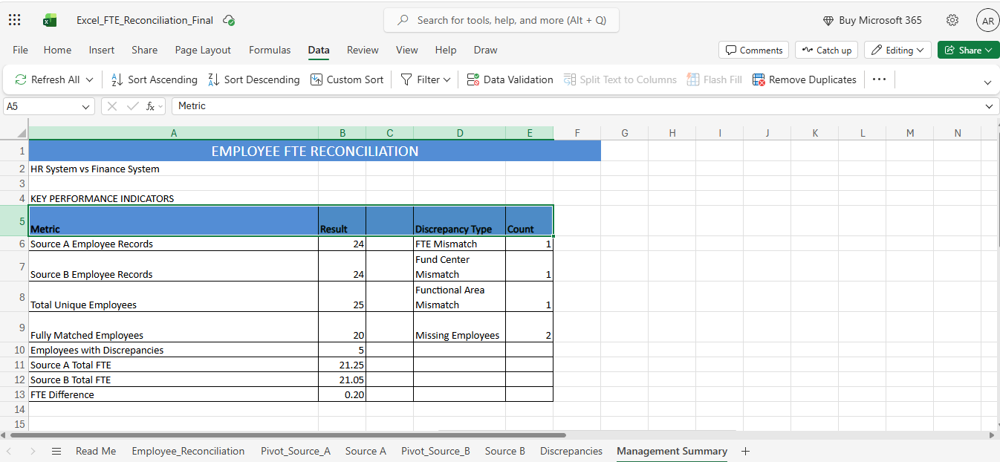
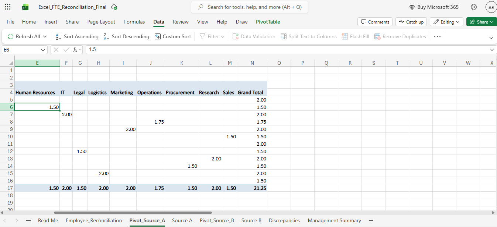
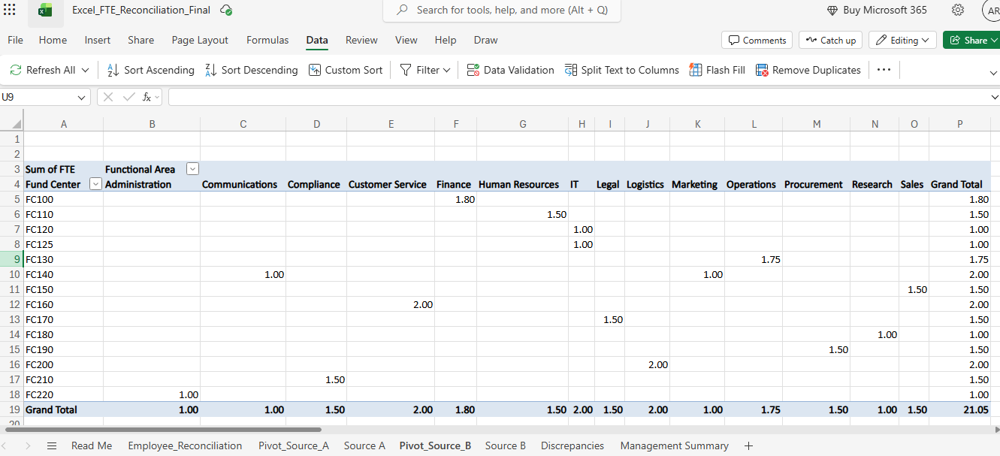
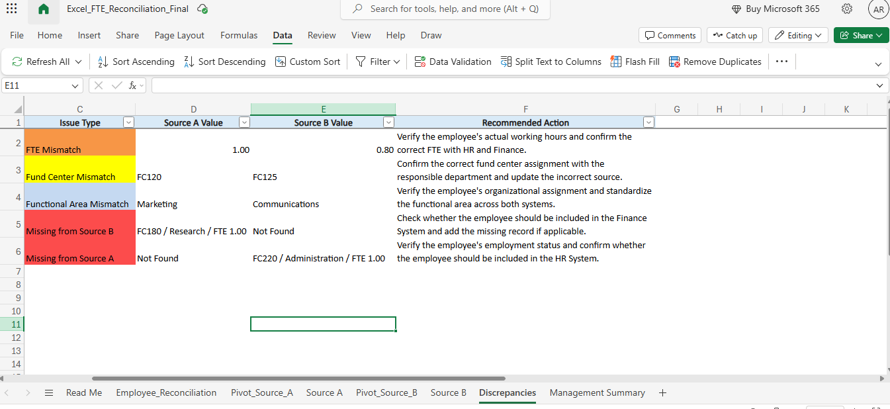

# Excel Data Reconciliation and FTE Reporting Dashboard

## Project Overview
This project demonstrates how Excel can be used to reconcile employee Full-Time Equivalent (FTE) data from two different systems: HR and Finance.

The objective is to identify discrepancies, compare employee records, and present findings through a management dashboard.

## Tools & Skills
- Microsoft Excel
- XLOOKUP
- Pivot Tables
- IF and COUNTIF formulas
- Conditional Formatting
- Data Reconciliation
- Dashboard Reporting

## Project Workflow
1. Reviewed and compared data from two source systems.
2. Checked data quality and record completeness.
3. Created Pivot Tables to summarize FTE by Fund Center and Functional Area.
4. Used XLOOKUP to reconcile employee records.
5. Identified discrepancies between the two sources.
6. Created a discrepancy report and management dashboard.

## Key Findings
- 25 unique employee records.
- 20 fully matched employees (80%).
- 5 employees with discrepancies.
- 1 FTE mismatch.
- 1 Fund Center mismatch.
- 1 Functional Area mismatch.
- 2 missing employee records.
- Source A total: 21.25 FTE.
- Source B total: 21.05 FTE.
- Total FTE difference: 0.20.

## Business Recommendation
Further verification with the relevant departments is recommended before making any changes to the source records.

## Project Deliverables
- Excel reconciliation workbook.
- Pivot Table summaries.
- Employee reconciliation report.
- Discrepancy report.
- Management summary dashboard.

## Data Disclaimer
This project uses fictional employee data created for learning and portfolio demonstration purposes.

## Project Screenshots

### Management Summary Dashboard

### Source A Pivot Table

### Source B Pivot Table

### Discrepancy Report

